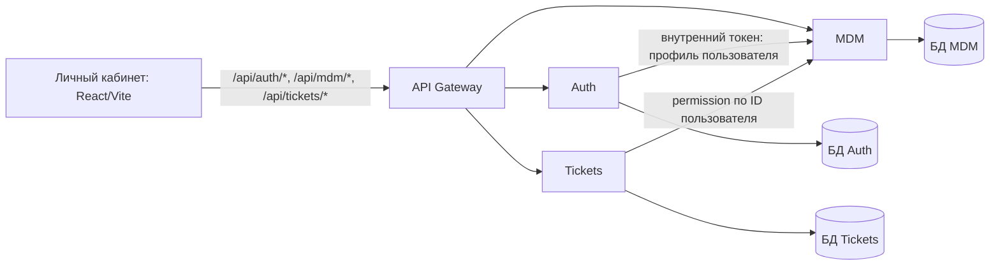

# Архитектура проекта - v1 - 20.11.2026

Документ описывает текущую реализацию личного кабинета, API Gateway, Auth, MDM и Tickets. Он отражает код и Compose-конфигурации в этой ветке. AD FS и синхронизация пользователей пока не подключены.

## Схема сервисов



Личный кабинет использует один адрес Gateway. В dev это `http://localhost:4052`, в production — `https://api.core.fesmu.ru`. Префикс запроса удаляется при проксировании: `/api/tickets/*` уходит в Tickets без `/api/tickets`, `/api/mdm/*` — в MDM без `/api/mdm`, `/api/auth/*` — в Auth без `/api/auth`.

| Компонент | Ответственность | Данные |
| --- | --- | --- |
| LK (`apps/lk`) | Вход, профиль, интерфейс и gRPC-Web запросы через Gateway | JavaScript получает только ID пользователя; JWT находится в `HttpOnly` cookie |
| API Gateway | Единая внешняя точка API, CORS, JWT-проверка, маршрутизация и формирование доверенных identity-заголовков | Секреты из окружения |
| Auth | Проверка внешней идентичности, связь с ID пользователя MDM и выпуск JWT | Отдельная БД связок тестовых учётных записей |
| MDM | Профили пользователей, роли, permissions и ограничения на операции с профилем | `dvgmu_mdm_db` |
| Tickets | Создание и выдача задач с проверкой permissions и владельца | `dvgmu_tickets_db` |

## Вход и выпуск токена

Сейчас используется тестовый адаптер Auth с локальной таблицей `auth_test_identities`. Пароли хранятся как bcrypt-хеши. Запись связывает email и внешний subject с числовым ID пользователя MDM.

```mermaid
sequenceDiagram
    actor U as Пользователь
    participant LK as Личный кабинет
    participant GW as Gateway
    participant A as Auth
    participant ADB as БД Auth
    participant M as MDM

    U->>LK: email и пароль
    LK->>GW: POST /api/auth/v1/auth/token
    GW->>A: POST /v1/auth/token (без JWT)
    A->>ADB: найти identity и проверить bcrypt
    A->>M: UserFetchByID с X-Internal-Service-Token
    M-->>A: профиль, статус, роли, permissions
    A->>A: проверить активность и подписать JWT
    A-->>LK: Set-Cookie: HttpOnly JWT; JSON с user_id
```

Auth выпускает JWT сроком на 15 минут. В нём находятся issuer `dvgmu-auth`, UUID пользователя (`sub`), числовой MDM ID (`uid`), роли, permissions и время истечения. Токен помещается в cookie `dvgmu_access_token` с флагами `HttpOnly`, `SameSite=Lax`, `Path=/`; `Secure` включён в production. JavaScript получает только `user_id`, чтобы запросить собственный профиль, и не может прочитать JWT. При входе в MDM Auth использует `INTERNAL_SERVICE_TOKEN`; этот токен разрешает только метод `UserFetchByID`, необходимый для получения профиля.

Сейчас `AUTH_PROVIDER=test-db`. Интерфейсы `IdentityProvider` и `IdentityMapper` отделяют проверку внешних учётных данных от сопоставления identity с пользователем MDM. Для перехода на AD FS тестовый provider заменяется OIDC provider, а mapper связывает issuer/subject или AD object ID с записью пользователя MDM. Синхронизатора AD пока нет.

## Проверка запросов в Gateway

Маршруты `POST /api/auth/v1/auth/token`, `GET /api/auth/v1/auth/session` и `POST /api/auth/v1/auth/logout` доступны без предварительной проверки JWT в Gateway. В Auth проверка сессии требует действующую cookie; выход удаляет её. Остальные Auth-маршруты и все запросы к MDM и Tickets требуют cookie с действующим JWT.

Gateway проверяет HMAC-SHA256 подпись, issuer и срок действия JWT из cookie. Затем он удаляет от клиента заголовки `X-Authenticated-*` и `X-Gateway-Secret`, устанавливает их заново по проверенным claims и удаляет cookie перед пересылкой запросов в MDM и Tickets. Так клиент не может выбрать для запроса чужой ID или роль, а JWT не передаётся рабочим сервисам.

Gateway разрешает только перечисленные CORS origins и включает credentials для браузерных запросов. Если браузер прислал `Origin` вне списка, Gateway отклоняет запрос. Cookie использует `SameSite=Lax`; в dev `Secure=false`, чтобы она работала по localhost HTTP, а в production `Secure=true`.

Сервисы MDM и Tickets сравнивают `X-Gateway-Secret` со своим секретом окружения. Это подтверждает, что identity-заголовки пришли через доверенный Gateway. В production только Gateway подключён к внешней сети Traefik; Auth, MDM и Tickets связаны отдельной сетью `dvgmu-backend` и не публикуют порты наружу.

## Как работают роли и permissions

Роли и permissions решают разные задачи:

| Доступ | Условие |
| --- | --- |
| Административные операции MDM: список, создание и изменение пользователя, назначение ролей | В JWT есть роль `USER_ROLE_ADMIN` |
| Чтение своего профиля MDM | Числовой ID в запросе совпадает с `X-Authenticated-User-ID` |
| Чтение чужого профиля | Роль `USER_ROLE_ADMIN` |
| Получение списка задач | Permission `USER_TASK_READ` в MDM |
| Создание задачи | Permission `USER_TASK_CREATE` в MDM |
| Получение задач конкретного владельца | ID берётся из Gateway, запрос к БД фильтруется по `tasks.user_id` |

В `EffectivePermissions` пользователь с ролью Admin получает все объявленные permissions MDM. Поэтому для Tickets администратор проходит те же проверки `TASK_READ` и `TASK_CREATE`, без отдельного обхода в Tickets. Для ролей Student и Employee автоматических разрешений нет: их доступ определяется назначенными permissions. В текущих операциях MDM административные действия защищены ролью Admin.

Tickets при каждом чтении или создании запрашивает профиль пользователя у MDM по ID из Gateway и проверяет нужный permission. Поэтому изменение permissions в MDM учитывается следующим запросом к Tickets. Роли в JWT используются MDM для проверки административных действий. Auth обновляет JWT и cookie через `/session` при загрузке кабинета и затем каждые 10 минут, пока вкладка открыта; изменение роли для административных действий обычно проявится после следующего такого обновления.

## Создание и чтение задач

Фронтенд отправляет в Tickets только заголовок задачи. Пользовательский ID удалён из `CreateTaskRequest` и `ListTasksRequest` protobuf: его нельзя подменить телом запроса. Tickets берёт ID из проверенного Gateway-заголовка, проверяет permission в MDM, сохраняет `user_id` вместе с задачей и при выдаче фильтрует список по этому владельцу.

Миграция `services/tickets/db/migrations/task/00002_add_task_owner.sql` добавляет колонку владельца. Уже существовавшие задачи сохраняются в БД с `NULL` владельцем, потому что до миграции сервис не записывал, кто создал задачу. Они не попадут в пользовательские списки, пока владелец не будет установлен отдельно.

## Секреты и конфигурация

Основные переменные находятся в корневом `.env.example`:

| Переменная | Использование |
| --- | --- |
| `JWT_SECRET` | Подпись и проверка JWT в Auth и Gateway; минимум 32 байта |
| `GATEWAY_SHARED_SECRET` | Доверие MDM и Tickets к identity-заголовкам Gateway; минимум 32 байта |
| `INTERNAL_SERVICE_TOKEN` | Вызов Auth → MDM для загрузки профиля при входе |
| `AUTH_COOKIE_DOMAIN` | Необязательный домен cookie; по умолчанию cookie привязана к хосту Gateway |
| `AUTH_COOKIE_SECURE` | В dev выключен для localhost HTTP, в production включён |
| `GATEWAY_ALLOWED_ORIGINS` | CORS для локальной разработки |
| `GATEWAY_PROD_ALLOWED_ORIGINS` | CORS для production origin кабинета |
| `GATEWAY_DOMAIN`, `TRAEFIK_ENTRYPOINTS`, `TRAEFIK_CERT_RESOLVER` | Внешний маршрут Gateway в production Compose |
| `VITE_GATEWAY_URL` | Необязательный адрес Gateway при сборке фронтенда; пустое значение включает dev/prod origin по умолчанию |

Используются три отдельные базы: `dvgmu_auth_db`, `dvgmu_mdm_db`, `dvgmu_tickets_db`. В dev Compose порты сервисов опубликованы на localhost для работы отдельных Compose-проектов; браузер всё равно обращается к Gateway.

Для локального запуска:

```sh
cp .env.example .env
make dev
```

Перед запуском заполните `JWT_SECRET`, `GATEWAY_SHARED_SECRET` и `INTERNAL_SERVICE_TOKEN` уникальными случайными значениями.

Тестовая identity создаётся для существующего ID пользователя MDM через `AUTH_TEST_USER_ID`, `AUTH_TEST_EMAIL` и `AUTH_TEST_PASSWORD`, затем командой `make auth-test-user`. Для production `make prod-up` создаёт `dvgmu-backend` и запускает MDM, Tickets, Auth и Gateway. Сеть Traefik `traefik-network` должна уже существовать.

## Текущие ограничения

- Auth проверяет тестовые учётные записи; AD FS и синхронизация с AD не подключены.
- JWT действует 15 минут и обновляется при активной открытой вкладке каждые 10 минут. Централизованный отзыв токенов и отдельные сессии устройств не реализованы; после сна вкладки дольше срока действия пользователь должен войти снова.
- `HttpOnly` не позволяет прочитать JWT из JavaScript, но XSS всё ещё может отправлять запросы от имени пользователя. Нужны защита от XSS и строгий allowlist CORS origins.
- Профильный ID возвращается браузеру для запроса собственного профиля. Серверная авторизация не полагается на это значение: для API используется ID из JWT, установленный Gateway.
- Перед production необходимо задать уникальные случайные секреты и сверить домен, CORS origin и имя TLS certificate resolver с настройками конкретного Traefik.
